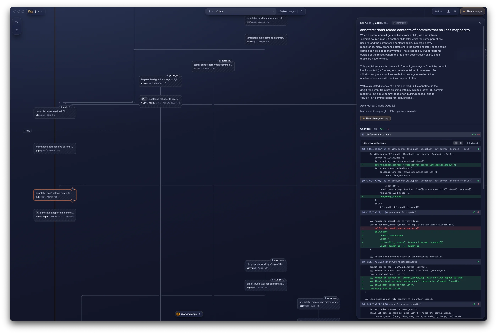

# Zanshin

Zanshin is a macOS desktop client for the
[Jujutsu (jj)](https://www.jj-vcs.dev/latest/) version control system. It is
built around jj's own model — changes, the operation log, bookmarks — rather
than being a Git GUI with jj added on: a commit graph you work in directly,
an undo timeline over the operation log, bookmarks, and push/fetch.

> **Status:** pre-1.0 and work in progress. macOS only. There are no release
> builds yet; expect missing features and breaking changes.



**How it fits together.** The UI is Flutter (`app/`, `packages/`). The
repository work is Rust (`crates/`) on top of
[`jj-lib`](https://crates.io/crates/jj-lib), loaded into the app as a native
library through a Dart build hook; data crosses the boundary as FlatBuffers
([ADR-0001](docs/adr/0001-ffi-data-transport-flatbuffers.md)). Zanshin
replicates the jj CLI's observable behaviour at the pinned version, and
`crates/zanshin-parity` checks that against the stock CLI.

| Path                                                        | What it is                                                                                             |
|-------------------------------------------------------------|--------------------------------------------------------------------------------------------------------|
| `app/`                                                      | the Flutter macOS app (features under `app/lib/src/features/`)                                         |
| `packages/zanshin_core`                                     | the pure-Dart bridge to the Rust library (FFI, worker isolate)                                         |
| `packages/zanshin_ui`, `zanshin_shell*`, `zanshin_settings` | UI components, window shell, settings                                                                  |
| `crates/zanshin-jj`                                         | jj operations on `jj-lib` (open, log, rebase, squash, push, …)                                         |
| `crates/zanshin-ffi`                                        | the C ABI the app loads (`cdylib`)                                                                     |
| `crates/zanshin-parity`                                     | parity oracle: runs the stock jj CLI and compares                                                      |
| `crates/zanshin-mcp`                                        | an MCP server over the same operations (experimental)                                                  |
| `docs/`                                                     | ADRs, the FFI ABI, graph layout, coverage, setup                                                       |
| `spikes/`                                                   | throwaway experiments; `graph-layout-ab` still generates the graph recordings                          |
| `_bmad-output/`                                             | planning artifacts and the design system (see [How this project is built](#how-this-project-is-built)) |

## Toolchain

All toolchains are installed system-wide. **No FVM, no per-project rustup
overrides.**

| Tool    | Pin                                    | Source-of-truth                                                          |
|---------|----------------------------------------|--------------------------------------------------------------------------|
| Rust    | `1.99.1`                               | `rust-toolchain.toml` (auto-applied by `rustup` on `cargo` invocation)   |
| Flutter | `main` channel, ≥ `3.44.0-1.0.pre-573` | `app/pubspec.yaml` → `environment.flutter`; this README is the human pin |
| Dart    | `main` channel, ≥ `3.13.0-104.0.dev`   | `app/pubspec.yaml` → `environment.sdk`; bundled with Flutter `main`      |
| `flatc` | `25.12.19`                             | `docs/development-setup.md`; FlatBuffers FFI-wire compiler (ADR-0001)    |

**Why these versions:**

- **Rust `1.99.1`** — pinned exactly so every machine produces the same
  compiler output. Bumps are explicit changes with a `# WHY:` rationale.
- **Flutter `main` channel** — the app creates its windows from Dart with
  Flutter's multi-window API, which is not in any stable channel release yet.
  Stable pins are not viable until multi-window support ships on a stable
  Flutter. Revisit then.
- **Dart `main` channel** — bundled with Flutter `main`; tracks in lockstep. No
  independent Dart pin.
- **`flatc 25.12.19`** — the FlatBuffers compiler that generates the Rust and
  Dart FFI-wire accessors (ADR-0001). It must stay on the same `25.x` line as
  the `flatbuffers` crate (`=25.12.19`) and the `flat_buffers` Dart package (`^25.9.23`); move all three together. See
  `docs/development-setup.md`.

**One-time install (per machine):**

```sh
# Rust — rustup auto-installs 1.99.1 the first time you cd into the repo and run cargo,
# but you can pre-install:
rustup install 1.99.1
# https://rustup.rs

# Flutter main channel (manual; no FVM):
#   https://flutter.dev/docs/get-started/install
# Then switch to main and pin via:
flutter channel main
flutter upgrade

# Mandatory: the app creates every window from Dart, so without this flag it
# builds but comes up with no window. Machine-global, compiled into the app.
flutter config --enable-windowing

# cargo-make (the build/test entry point):
cargo install cargo-make

# FlatBuffers compiler — generates the Rust + Dart FFI-wire accessors (ADR-0001).
# Keep it on the same 25.x line as the flatbuffers crate + flat_buffers package:
brew install flatbuffers
flatc --version   # must print 25.12.19

# Codegen tools for the C header (cbindgen) and Dart FFI bindings (ffigen):
cargo install cbindgen
dart pub global activate ffigen
```

See `docs/development-setup.md` for the full prerequisites and version-pin table.

**No CI.** There is no hosted CI; `cargo make test` (below) is the quality gate
and runs locally.

## Build & development

`cargo-make` is the single entry point for all build, test, and codegen tasks.

### list all available tasks

```sh
cargo make
```

### build Rust workspace (release) + Flutter macOS shell → unsigned .app

```sh
cargo make build
```

### run Flutter app in debug mode (Hot-Reload, local only)

```sh
cargo make run
```

### run Flutter app in release mode (local-optimized, no Hot-Reload)

```sh
cargo make run-release
```

### quality gate for what changed since its last green run (`test-full` runs every step)

```sh
cargo make test
cargo make test-full
```

### regenerate FlatBuffers accessors (flatc) + FFI C header (cbindgen) + Dart bindings (ffigen)

```sh
cargo make codegen
```

### check for codegen drift against committed files (manual discipline tool)

```sh
cargo make verify-codegen
```

### remove all build outputs (cargo + flutter); committed codegen stays

```sh
cargo make clean
```

## How do I … ?

### How the build chains together

`packages/zanshin_core/hook/build.dart` is a Dart Hook that uses
`native_toolchain_rust` to build `crates/zanshin-ffi` (the cdylib)
automatically whenever Flutter touches the app
— `flutter run`, `flutter build macos`, `flutter test` all trigger it.

**You don't need to run `cargo build` manually before `flutter run`.** The hook
handles it. The Rust workspace gets compiled in the same mode Flutter is in (debug → debug, release → release).

`cargo make build` exists for the release path because it _also_ builds the
non-FFI Rust artefacts (e.g. the `zanshin-mcp` binary), which the Flutter hook
does not touch.

### How do I run the app locally (Hot-Reload)?

```sh
cargo make run
```

The Dart Hook compiles `zanshin-ffi` in debug mode and links it into the app
bundle. Change Rust code → stop the app → re-run. (Hot-Reload only covers Dart;
Rust changes need a re-run.)

### How do I run the app locally (release-optimized)?

```sh
cargo make run-release
```

Same as above but with `--release` on both sides. Useful when debugging
perceived performance issues — Rust debug builds can be orders of magnitude
slower than release.

### How do I build a release artefact (unsigned `.app`)?

```sh
cargo make build
```

Produces `app/build/macos/Build/Products/Release/Zanshin.app`. Recommended
to run `cargo make test` first so you don't ship a broken artefact.

**Note:** the `.app` is unsigned and unnotarized. Codesigning, notarization,
Sparkle auto-update and GitHub Releases automation are deferred to the release
phase (see `_bmad-output/planning-artifacts/prd.md` § 4.7). For local use the
unsigned bundle is fine; macOS will warn on first launch.

### How do I run the quality gate before pushing?

```sh
cargo make test
```

Runs the gate: `cargo clippy` (pedantic, `-D warnings`), `cargo fmt --check`,
Rust doctests, `flutter test` / `dart analyze` / `dart format --check` per Dart
package, `cargo deny check advisories bans`, a `Cargo.toml` hygiene check (every
`default-features = false` needs an inline `# WHY:`), and the coverage ratchet,
which runs the Rust and `zanshin_core` test suites and fails if per-file Rust
line coverage drops ([docs/coverage.md](docs/coverage.md)).

It runs only the steps the changes since its last green run need (`cargo xtask gate-plan`); `cargo make test-full` runs
every step.

### The FFI wire format (ADR-0001)

Data crossing the Rust ↔ Dart boundary is shaped by its **type**, not by a
one-size envelope:

- **fixed scalar** (`int` / `bool` / `float`) → plain C value;
- **lone string** → `*mut c_char` (a `CString`; Dart frees it with
  `zanshin_string_free`);
- **composite** (table / list / nested) → a single **FlatBuffers** buffer; Dart
  releases it with `zanshin_buffer_free(ptr, len)` or, for the GC-backed
  `FfiBuffer` wrapper, the equivalent `zanshin_buffer_free_token`.

The wire schemas live in [`schemas/*.fbs`](schemas/README.md) and are the
source of truth. `flatc` generates the typed Rust and Dart accessors from them;
those accessors — like the C header and Dart bindings — are **committed** and
the build never regenerates them. (The only JSON in the project is
`zanshin-mcp`'s protocol-mandated JSON-RPC, a different boundary.) Full
rationale: [ADR-0001](docs/adr/0001-ffi-data-transport-flatbuffers.md).

### How do I change an `extern "C"` function in `zanshin-ffi`?

1. Edit the Rust source.
2. Regenerate: `cargo make codegen`.
3. Commit `crates/zanshin-ffi/include/zanshin_ffi.h` _and_
   `packages/zanshin_core/lib/src/ffi/bindings.dart` in the same change as the
   Rust edit.
4. Verify nothing drifted: `cargo make verify-codegen`.

### How do I change a wire schema (`.fbs`)?

1. Edit the `.fbs` in `schemas/`. (WIP: breaking changes are in-place edits — no
   `_v2` suffix, no in-wire `schema_version` field; update all callers in the
   same change.)
2. Regenerate both sides: `cargo make codegen`. This runs `flatc --rust` +
   `flatc --dart` (normalising the output with `rustfmt` / `dart format`), then
   `cbindgen` + `ffigen`.
3. Commit the schema diff **and** the regenerated accessors (`crates/zanshin-ffi/src/*_generated.rs`,
   `packages/zanshin_core/lib/src/ffi/*.ffi_generated.dart`) in the same
   change. The typed accessors turn a wrong-shape payload into a compile error,
   so update every caller.

Generated code is **committed** and the build never auto-regenerates it.
`cargo make verify-codegen` checks for drift; it is a manual check, not part of
the gate.

### How do I reset / start clean?

```sh
cargo make clean
```

Removes `target/` and `app/build/`. Committed codegen (`zanshin_ffi.h`,
`bindings.dart`, the `flatc` accessors) stays — those are source-of-truth
artefacts, not build outputs. If you _really_ want to reset codegen too, delete
the files manually and run `cargo make codegen`.

## Dependency security — cargo-deny

`cargo make test` runs `cargo deny --workspace check advisories bans` as
the security backstop. The full license-gate (`cargo deny check licenses`)
and Dart-side `pana` integration are deferred to the release phase (see `_bmad-output/planning-artifacts/prd.md` § 5.4).

### First-run advisory database download

On a fresh machine, the first invocation
fetches `https://github.com/rustsec/advisory-db` into
`~/.cargo/advisory-dbs/`. This is a one-time ~30–60s download.
Subsequent runs are local-only and finish in under 5s on this workspace.

To pre-warm the database without running the full check:

    cargo deny fetch db

### Advisory ignore-list workflow

When a published RUSTSEC advisory fires on a transitive dependency,
the response is **not** to ignore it silently. The procedure:

1. Investigate whether the advisory is exploitable in Zanshin's actual
   use of the affected dep.
2. Try `cargo update -p <crate>` to pick up a fixed version.
3. If neither resolves it, add an entry to `[advisories.ignore]` in
   `deny.toml` with an `id`, a non-empty `reason`, and a comment
   linking the upstream tracking issue.
4. The `unused-ignored-advisory = "warn"` setting surfaces stale
   ignores automatically — when the warn fires (advisory withdrawn,
   or dep upgraded away), drop the entry.

See `deny.toml` for the live config; every key carries an inline
comment explaining its choice.

## Project documentation

- `docs/development-setup.md` — full toolchain prerequisites (incl. `flatc`) + install commands
- `docs/adr/` — architecture decisions: FFI transport (FlatBuffers), repository state model, jj operation API
- `docs/ffi-abi.md` — the FFI contract between `zanshin_core` and the Rust library
- `docs/graph-layout.md` — the commit-graph layout engine
- `docs/coverage.md` — the coverage ratchet
- `schemas/README.md` — FlatBuffers wire-contract schemas + regeneration discipline
- `_bmad-output/planning-artifacts/` — PRD, architecture, epics, research
- `_bmad-output/project-context.md` — the implementation rules (tech stack, FFI, errors, testing)

## How this project is built

Zanshin is developed by one person with AI coding agents:
[Claude Code](https://claude.com/claude-code) writes most of the code, with
the [BMad Method](https://docs.bmad-method.org/) for planning and story-sized
work. The planning is kept in the repository on purpose, so the reasoning
behind the code stays readable:

- `_bmad-output/planning-artifacts/` — PRD, architecture, epics and research.
- `_bmad-output/implementation-artifacts/` — one spec per story or run, the
  sprint status, deferred work, the design system (`design_system/`) and the
  clickable design prototype (`design/`).
- `CLAUDE.md`, `.claude/` — agent instructions, skills and hooks for Claude Code.
- `docs/superpowers/` — design notes and plans from earlier agent sessions.

**None of this is required to build, run or change Zanshin.** The code, the
tests and `cargo make test` work without BMad or any AI tool. If you use a
coding agent, point it at `_bmad-output/project-context.md` — it holds the
rules the code follows.

## License

MIT ([LICENSE](LICENSE)). `crates/zanshin-jj` also contains code ported from
the jj CLI under Apache-2.0 ([LICENSE-APACHE](LICENSE-APACHE)). The bundled
fonts are under the SIL Open Font License (see `packages/zanshin_ui/assets/fonts/`).
